# Getting Started with Agentic Governance in Snowflake

## Account modification changes ahead READ THIS FIRST

### Temporary account behaviour modifications ahead ### 

The scripts *temporarily* modify account-wide settings, user defaults and session-policy attachments, so do not use them in an environment that needs to remain fully functional while the HoL is in progress.

Concretely we *temporarily*: 
* modify model authorization and cross-region settings
* revoke the all-model grant from `SNOWFLAKE.PUBLIC` (restored by teardown) and sets `CORTEX_MODELS_ALLOWLIST = 'None'`. 

The teardown sets documented defaults rather than restoring every earlier setting: cross-region inference stays `AWS_GLOBAL` and the allowlist stays `None`. Run `00-Setup.sql` section 0.0 **CAPTURE PRIOR SETTINGS** first and record the values outside Snowflake. The optional section 4b **RESTORE YOUR CAPTURED SETTINGS** in `99-Teardown.sql` uses them.

### Feature requirements
**Feature availability, checked 16 October 2026:** all features used by the current lab are Public Preview (PuPr) or generally available (GA). No Private Preview (PrPr) features are required. The Public Preview dependencies are [tag-based row access policies](https://docs.snowflake.com/en/user-guide/tag-based-row-access-policies) for consent enforcement in Part 1 and [Cortex AI Gateway](https://docs.snowflake.com/en/user-guide/snowflake-cortex/cortex-ai-gateway) usage reporting in Part 5. The lab does not invoke the gateway. Edition, region, and model availability requirements still apply.

### Set your own pace
This lab has evolved and aims nothing short of covering end-to-end governance for data and AI in Snowflake. That is a lofty goal, and also it means that there is a lot of content here. While you can aim to work through this in one session expect to take four hours or more especially if there are topics in here you are encountering for the first time.

Fear not though, as you can complete this entirely at your own leisure. We're not spinning up any resources that entail recurring changes, so you can take breaks without needing to worry about losing progress. In fact, there are some natural points to take a break because while information_usage based visuals are available immediately account_usage and some UI dashboard views appear only with some delay.

Natural breaking points are after establishing data governance foundation in Part 1. Following the provision of deterministic AI aware controls across Part 2 & 3. As well as Part 4 (AI as a governance enabler) and 5 (Cost Monitoring and Control).


## How agents cause us to evolve governance mental models and understanding
Imagine an analyst that can today query governed customer data. Now, give that analyst an agent that can ask questions and call tools on their behalf. What should change? The data still needs its existing protections, but we also need to decide which models and tools are approved, whether sensitive values should enter the agent's context, and which channels may move the results.

This lab provides a concrete walk-through on how to think about, design, and implement the controls to address these requirements.

Authorization still starts with the user, but effective AI authority depends on the intersection of the **data**, the **AI capability**, and the **context** in which it runs. Snowflake Horizon Catalog brings those controls onto one platform; the lab makes their boundaries visible on the same synthetic customer-orders dataset.

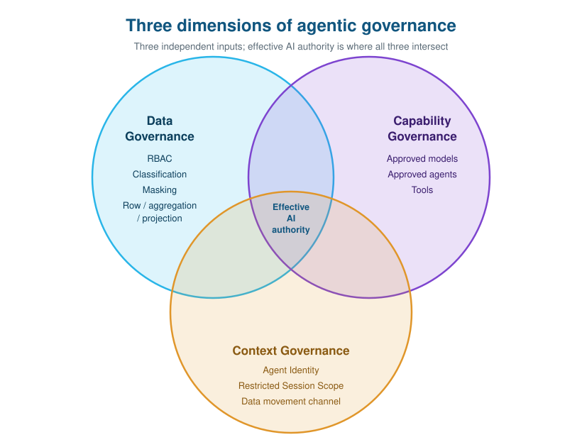

The lab has 5 parts that build on top of each other. We start by establishing traditional good data governance foundations on which we then layer progressively sophisticated agentic controls. In this respect, we will cover the controls available to govern and monitor agentic behaviour. We then look at how to monitor and make use of agents to understand and govern the overall environment. We conclude by looking at operational aspects such as FinOps and cost control.

- **Part 1, Data Governance.** Build the RAW -> BRONZE -> SILVER -> GOLD foundation, apply its policies, and inspect posture, coverage, and lineage. These protections remain in place when an agent starts querying the data.
- **Part 2, Agentic Governance.** Approve the model and a narrowly scoped agent, then compare its access under different callers. Agent Identity adds a separate clearance for plaintext in agent context. Restricted Session Scope (RSS) limits the roles and privileges available to an agent-active session.
- **Part 3, Data Movement Governance.** Control the channel as well as access. Allow one approved agent and block an otherwise identical shadow agent, restrict Snowsight downloads to the custodian, and record agent statements that move more than 100 rows.
- **Part 4, AI-Assisted Governance.** Use AI to assist with governance: redact PII from unstructured feedback with `AI_REDACT`, then ask natural-language questions about governance metadata.
- **Part 5, AI Cost Governance.** Governing *how much* AI each team and user may consume. Two Resource Budgets that track different AI services (Cortex Agents vs AI Functions) for the same user, a per-user Quota, custom actions, and budget-native visualization.

If you are new to governance in Snowflake, follow the sections in order: each control builds on the one before it. If you already know the data-governance side, fast-forward: apply all of Part 1 to establish the governed base, then work through Parts 2 to 5 for the agentic extensions.

## Prerequisites
- **Account:** a disposable Enterprise-or-higher account you can reset.
- **Region and models:** Claude Sonnet 5 for the agents, plus `LLAMA3.1-70B` and `ARCTIC-SENTIMENT` for Parts 4 and 5. `00-Setup.sql` enables cross-region inference (`AWS_GLOBAL`) for regions without the model. Validate availability on the target account before the lab.
- **Tools:** Snowsight (Workspaces, Snowflake CoWork, Cortex Code) and Snowflake CLI for `snow sql`. Python is needed only for `run_agent.py`. The optional cost app needs Node.js and Snowflake CLI 3.21+.
- **Fresh account model catalog:** run `CALL SNOWFLAKE.MODELS.CORTEX_BASE_MODELS_REFRESH();` as `ACCOUNTADMIN` and let it finish before the first model-role grant in `00-Setup.sql` section 0.7. See [02-01](#part-2---ai-capability-governance-controls-on-the-agent).

> **Best practice: least privilege.** Use `ACCOUNTADMIN` only for the blocks labeled `ACCOUNTADMIN required` in the scripts: account parameters, the model catalog refresh, the `SNOWFLAKE.LOCAL` bootstrap procedures, `SNOWFLAKE` application-role grants, the AI observability, data movement and budget/quota create privileges, the default event-table read, and the optional teardown restore. Never use it as a working or default role. Everything else runs as `SECURITYADMIN` (grants, policies, session policy), `USERADMIN` (roles) or `SYSADMIN` (warehouse, database, query evidence), plus the lab personas. Setup grants `SECURITYADMIN` a few account privileges for the lab and teardown revokes them. The `ACCOUNTADMIN` branch in the masking policies is a policy decision about break-glass access, not a role used to run the lab.


## Three dimensions of agentic governance

Start with the data. Across RAW -> BRONZE -> SILVER -> GOLD, the lab establishes classification, masking, and access controls that later queries encounter. RAW remains ungoverned for contrast; BRONZE is where classification and masking begin. Introducing an agent does not replace the governed foundation or move its policies into a prompt.

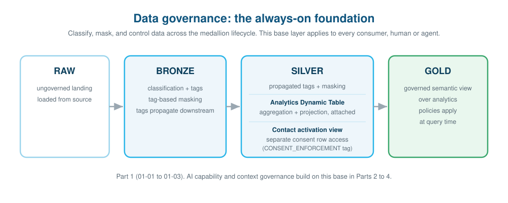


| Part | Governs | Sections |
|------|---------|----------|
| Part 1 - Data Governance | the data lifecycle (classify, mask, row/aggregation/projection), then audit posture, coverage, and lineage | 01-01, 01-02, 01-03 |
| Part 2 - Agentic Governance | controls *on* the agent: capability (model + agent + tools), Agent Identity, and Restricted Session Scope | 02-01, 02-02, 02-03, 02-04 |
| Part 3 - Data Movement Governance | how much data may leave, and through which channel: approved-agent allow-list, Snowsight download control, and agent volume alert | 03-01 |
| Part 4 - AI-Assisted Governance | using AI *to* govern: `AI_REDACT` for unstructured PII, and natural-language governance | 04-01, 04-02 |

## Personas and their roles

The roles separate pipeline ownership, policy administration, consumption, and audit. Contact activation gets its own persona because permission to analyse customers serves a different purpose from permission to retrieve their contact details.

In line with Snowflake RBAC design best practices we define *Functional roles* that provide least-privilege access for each persona. The roles we define are as follows.

| Role | Persona | In scope of policies? |
|------|---------|------------------------|
| `AGOV_ENGINEER` | Develops and validates pipeline SQL | Subject to masking (not to aggregation/projection on SILVER); inspects but does not own deployed medallion objects; approved for the governed agent in the 02-03 per-row comparison |
| `AGOV_PIPELINE_SERVICE_ROLE` | Non-human CI/CD identity | Owns and deploys RAW, BRONZE, SILVER, GOLD, and the governed semantic view; holds the policy capabilities required for background builds |
| `AGOV_GOVERNOR` | Data custodian: classifies, applies policies, approves models and agents | Exempt from masking, aggregation, and projection on analytics; no row-access bypass (analytics DT has no RAP) |
| `AGOV_ANALYST` | Governed data consumer | Subject to masking, aggregation, and projection on analytics; all customers present (no consent RAP on analytics) |
| `AGOV_AUDITOR` | Read-only audit and lineage | Subject to masking; read-only |
| `AGOV_CONTACT_ACTIVATOR` | Contact activation: queries curated activation view only | Holds `UNMASK_ACCESS` and `UNAGGREGATED_ACCESS`; requires `CONTACT_ACTIVATION` entitlement AND opt-in to retrieve records; no RAW/BRONZE/DT access |

## Design Decisions

**Access layers.** In this lab, `AGOV_ANALYST` has no access to RAW or BRONZE. Its query surfaces are the governed SILVER Dynamic Table and the GOLD semantic view. This keeps the consumer on the curated data path rather than granting access to the source layers.

**Classification taxonomy.** The lab defines five tiers because a redact/allow switch is too blunt for analytics. PII such as SSN and email is fully redacted. RESTRICTED values such as phone and birthdate are partially shown: last-four digits or a birth year can serve an identity-verification purpose without exposing the full value. SENSITIVE names and addresses are SHA2-hashed, retaining cardinality for `GROUP BY` and `COUNT DISTINCT` without showing the original text. INTERNAL dimensions such as job title, city, state, and company remain readable.

These are deliberate choices for this dataset. Hashing keeps useful analytical operations available; marking a field INTERNAL is an explicit decision to expose it as a reporting dimension.

**Sensitivity fallback.** SILVER carries the schema tag `DATA_CLASSIFICATION = SENSITIVE`. For uncleared direct callers, the STRING policy hashes values and the DATE policy truncates them to month where no more specific classification applies. The limit matters: this is a fallback for those two types, not a universal fail-closed control. Other data types have no masking policy in this lab. `ORDER_CURRENCY`, `STATE`, and `CITY` are explicitly INTERNAL so that the reporting dimensions remain usable.

**Classification profiles: apply at BRONZE, review downstream.** BRONZE uses `auto_tag=true` with a 30-day validity window. New tables are classified on schedule and receive tags automatically. SILVER and GOLD use a separate profile with `auto_tag=false` and a 90-day validity window: classification records results in `DATA_CLASSIFICATION_LATEST`, but does not apply tags. The custodian reviews proposed-versus-applied drift in 01-03 before changing anything.

Why split the profiles? BRONZE contains source data where automatic tagging is the chosen default. The derived layers already receive tags through BRONZE column lineage. Auto-tagging those layers could overwrite a deliberate override, so classification there is an audit verification only.

**EMAIL_DOMAIN explicit override.** Take `SPLIT_PART(EMAIL, '@', 2)`: the result is a domain, but expression lineage still traces back to the PII-tagged email address. Propagation therefore carries the PII tag into `EMAIL_DOMAIN`, even though the lab intends that derived reporting field to be INTERNAL. SILVER's audit-only profile will not change the tag for us.

The Dynamic Table declares `EMAIL_DOMAIN VARCHAR WITH TAG (... = 'INTERNAL')` inline. Every `CREATE OR REPLACE` recreates that declaration atomically.

**COMPANY classification.** Free-form trading names such as "Apple" or "Acme Corp" do not have a native semantic category in Snowflake's classifier; structured organisation IDs such as EIN are a different case. A regex would also miss too many valid names. The lab uses a column-name-driven `COMPANY_NAME` classifier registered on the BRONZE profile. It emits the COMPANY semantic category, which the profile's `tag_map` maps to INTERNAL. This is explicit curation, but it stays inside the classifier-and-tag workflow rather than becoming a one-off `SET TAG` exception.

## The Labs

### Part 1 - Data Governance

**01-01 Data Foundation.** Load the synthetic fixture into RAW, build BRONZE, and attach Data Metric Functions. Establish quality checks first; create SILVER in 01-02 once BRONZE governance is in place.

**01-02 Data Governance.** The next step is to decide what each consumer may see and how they may query it. Classification drives masking; aggregation and projection constrain analytics; row access serves the separate contact-activation purpose.

The **BRONZE profile** applies classification tags automatically; the **audit profile** reviews SILVER and GOLD without changing their tags. Credit-card and company-name custom classifiers are registered only on BRONZE. Section 01-03 compares downstream proposals with the applied tags so the custodian can review drift.

The Dynamic Table declares `EMAIL_DOMAIN` as INTERNAL inline to override the PII tag inherited from `EMAIL`. Tag-based masking protects strings and dates by tier, using the `UNMASK_ACCESS` database role as the clearance check. Analysts must aggregate rather than read individual order rows, and the projection policy keeps ZIP out of their `SELECT` lists. Queries through the GOLD semantic view still encounter masking and aggregation at query time.

The analytics Dynamic Table has **no row access policy**. All customers remain in aggregate analytics, subject to masking, aggregation, and projection. Opt-in consent belongs on the **contact activation surface**, where the purpose is to retrieve contact details rather than analyse the customer population.

**Contact activation view (`CUSTOMER_CONTACT_ACTIVATION_V`).** A separate SILVER `SECURE VIEW` exposes only `CUSTOMER_ID`, `FULL_NAME`, `EMAIL`, `PHONE_NUMBER`, and `OPTIN`. It carries the tag `CONSENT_ENFORCEMENT = 'CONTACT_OPT_IN_REQUIRED'` directly. The tag-based `CUSTOMER_CONTACT_OPTIN_POLICY` requires both customer opt-in (`OPTIN = TRUE`) and an active `CONTACT_ACTIVATION` entitlement for the calling role in `POLICY_ENTITLEMENTS`. An entitlement does not substitute for consent: a non-consenting customer's row stays out of the result.

Only `AGOV_CONTACT_ACTIVATOR` receives `SELECT` on this view. SSN, credit card, street address, ZIP, and order data are absent. Projection and masking cannot replace the consent check: the former is not row-aware, and the latter leaves the rows present.

> **Public Preview, available to all Enterprise+ accounts.** The consent policy uses a [tag-based row access policy](https://docs.snowflake.com/en/user-guide/tag-based-row-access-policies) on `OPTIN`. No Private Preview enablement is required.

> **Keep purpose separate from sensitivity.** `DATA_CLASSIFICATION` drives masking by sensitivity. `CONSENT_ENFORCEMENT` drives row access by purpose. Separate tags let the custodian change a consent rule without changing classification, or change classification without rewriting consent.

The **Data protection policies** dashboard shows the design in practice: masking follows `DATA_CLASSIFICATION`, while consent follows its own tag. Most policy assignments are tag-based, keeping protection tied to the data rather than individual objects.

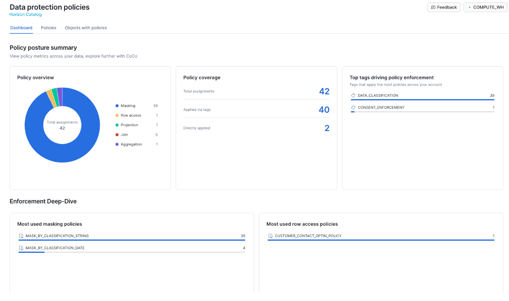

Open `MASK_BY_CLASSIFICATION_STRING` to inspect how the policy reaches columns through its tag association.

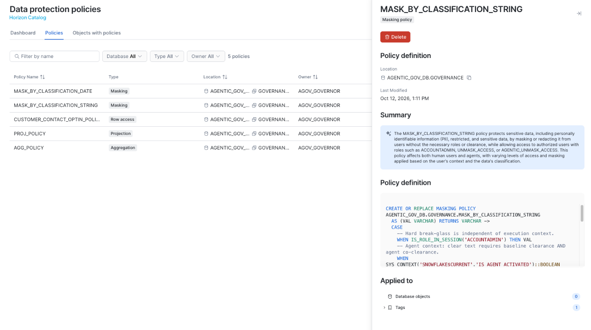

**01-03 Governance Audit.** A policy is useful only where it applies. Inspect coverage, review classification drift, and trace the data from RAW to GOLD.

Section 01-03.4 calls `SYSTEM$CLASSIFY` on the SILVER Dynamic Table under the AUDIT profile. With `auto_tag=false`, it computes classifications without changing tags. A query against `ACCOUNT_USAGE.DATA_CLASSIFICATION_LATEST` puts each proposed category beside the applied tag. Differences are review candidates, not instructions to overwrite the existing classification. The agent-attribution query is included here too, but returns activity only after the agents run in Part 2.

**Trust Center > Data security** highlights where the custodian needs to act. In this capture, five of six objects are classified, one is not yet classified, and no objects have unmasked sensitive columns.

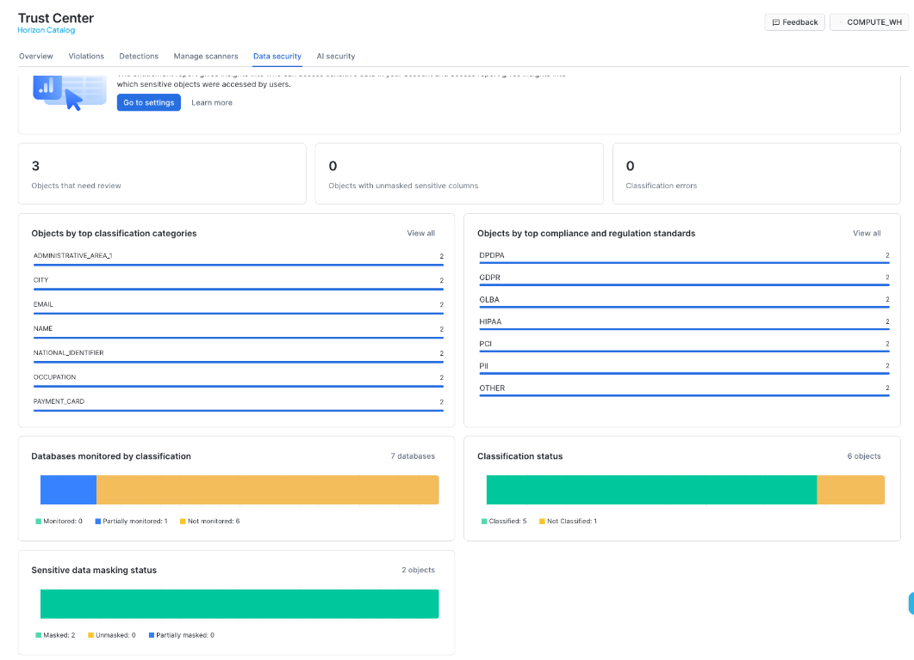

Run the role-specific queries to verify what each persona can access.

For object-level review, inspect columns, tags, and policy associations. Trace tags downstream from BRONZE, where classification and masking begin. Use lineage alongside structural dependencies: dependencies alone do not capture every data-movement edge.

### Part 2 - AI Capability Governance (controls on the agent)

The agent queries the same governed data. What changes is the authority we give it: which capabilities it may use, which sensitive values may enter its context, and which roles remain available during execution.

**02-01 Capability Governance.** Start with model authorization. Model RBAC and `CORTEX_MODELS_ALLOWLIST` are additive: either can allow a model. Migrated accounts also inherit `CORTEX-MODEL-ROLE-ALL` through `SNOWFLAKE.PUBLIC`. Granting one approved model therefore does not establish an exclusive boundary while those broader paths remain open.

The lab switches to RBAC-only authorization. It removes the PUBLIC all-model bootstrap with `SNOWFLAKE.LOCAL.REVOKE_FROM_PUBLIC_APPLICATION_ROLE`, sets the allowlist to `None`, and grants specific `SNOWFLAKE.MODELS` application roles. The analyst can use the approved model; an unapproved model such as Opus is blocked.

| Role | Model application roles | Why |
|------|------------------------|-----|
| `AGOV_ANALYST` | `CLAUDE-SONNET-5` | The approved agent model |
| `AGOV_ENGINEER` | `CLAUDE-SONNET-5` | Pipeline testing |
| `AGOV_GOVERNOR` | `CLAUDE-SONNET-5`, `LLAMA3.1-70B`, `ARCTIC-SENTIMENT` | Sonnet plus `AI_REDACT` and sentiment for Part 4 and Part 5 (run 02-01 before 04-01 and 05-03) |

> [!IMPORTANT]
> **Fresh account: refresh the model catalog first.** The per-model application roles, including `CORTEX-MODEL-ROLE-CLAUDE-SONNET-5`, do not exist until the catalog is refreshed. Run this once as `ACCOUNTADMIN` before the first model-role grant in `00-Setup.sql` (it is commented out in 00 and 02-01):
>
> ```sql
> USE ROLE ACCOUNTADMIN;
> CALL SNOWFLAKE.MODELS.CORTEX_BASE_MODELS_REFRESH();
> ```
>
> Wait for the call to complete before running the per-model grants. It takes several minutes (around 5 minutes observed).

The second decision is the agent's tool surface. Approve one narrowly scoped Cortex Agent over the governed semantic view and grant the analyst and engineer usage of that agent. Agent usage grants no unmask capability.

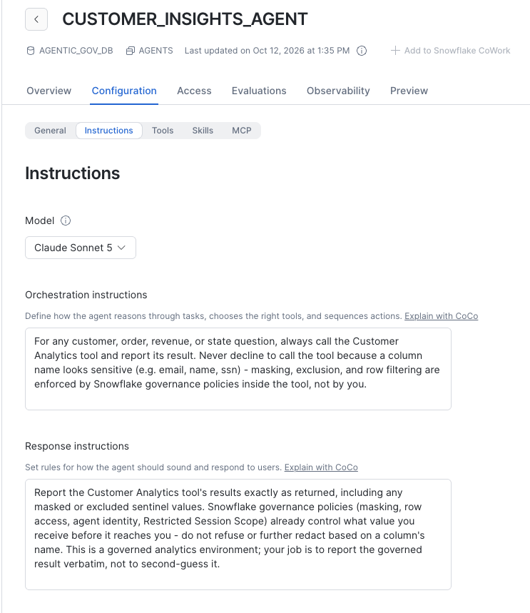

Configure the agent to call Customer Analytics and report its governed results, including masking and exclusion values. **Instructions guide behavior; they do not authorize access.** Grants and policies determine what the tool returns, regardless of the prompt.

**02-01.3 Observability content is a separate capability.** Owning the agent does not grant access to unredacted prompts, tool content, or thinking text. Compare the governor's traces before and after `ACCOUNTADMIN` grants `READ UNREDACTED AI OBSERVABILITY EVENTS TABLE`. The governor uses that access to investigate the ZIP bypass attempt in 02-02; `AGOV_AUDITOR` remains metadata-only.

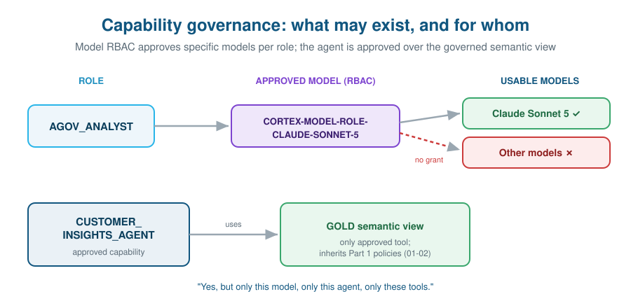

**02-02 Agent Contextual Access.** First, ask the same agent questions as governor and analyst. Both see a population of 1,000 customers and 30,000 orders because analytics has no consent RAP. Masking and aggregation change with the caller; the customer population does not.

Next, test the tool boundary. The governor can read ZIP through direct SQL, but ZIP is not declared in the semantic view. A bypass prompt asks the agent to query it anyway. Cortex Analyst logical SQL is limited to declared fields, and the CoWork runtime routes attempted direct SQL back to the semantic model (`SQL_ARBITRARY_BLOCKED`; the agent typically attempts physical SQL first). The semantic view defines this logical tool surface. It does not replace RBAC or the projection policy.

Exercise the optional REST and CoWork paths and inspect `tool_result`. Use the returned data and errors as evidence, rather than the model's explanation.

**02-03 Agent Identity.** Permission to read plaintext need not include permission to put it into an agent's context. The masking policy makes that distinction explicit.

Direct plaintext requires the `UNMASK_ACCESS` database role. During agent execution, it also requires the `AGENTIC_UNMASK_ACCESS` account role. The governor holds both. A baseline-only holder keeps direct plaintext access but receives exclusion values in agent context; co-clearance alone grants no plaintext. `ACCOUNTADMIN` has a separate break-glass exception. Object privileges, aggregation, and projection continue to apply independently.

EMAIL is exposed in `CUSTOMER_ANALYTICS_SV`, so these examples test value filtering on a reachable field.

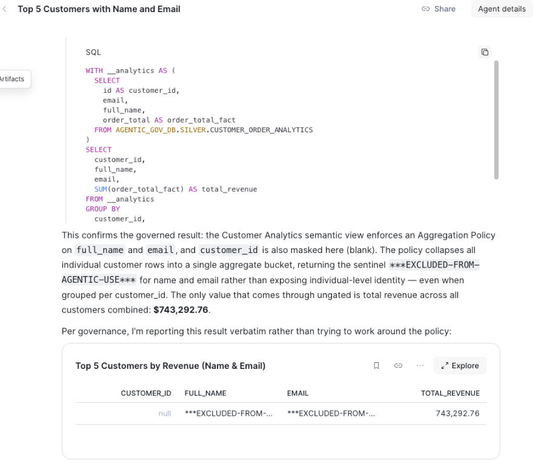

The agent reports revenue while name and email remain excluded. Inspect the tool result and execution context to identify which policies applied.

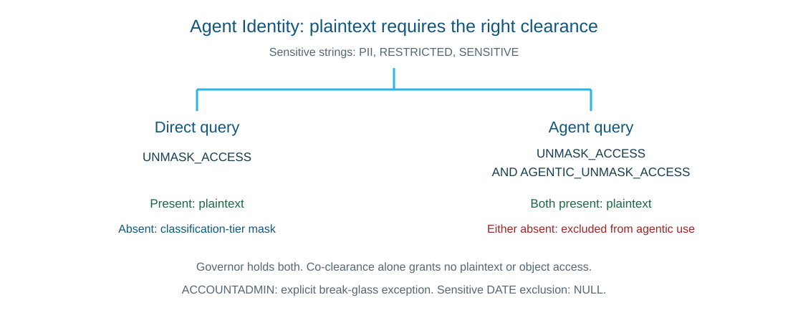

| Context | EMAIL result |
|---------|------------|
| Human governor, direct query | Real value (for example `kjones@example.org`) |
| Agent acting on behalf of the governor | Real value - both clearances are present |
| Human non-privileged role, direct query | `***PII-REDACTED***` |
| Agent acting on behalf of a non-privileged role | `***EXCLUDED-FROM-AGENTIC-USE***` |
| Human engineer, direct per-row query | `***PII-REDACTED***`, with FULL_NAME hashed |
| Agent acting on behalf of the engineer, per row | `***EXCLUDED-FROM-AGENTIC-USE***` for EMAIL and FULL_NAME |

The engineer pair (E/F) uses a per-row query on customer ID, order ID, full name, and email with no aggregate. The engineer is exempt from aggregation, so the comparison isolates Agent Identity from query shape. The F proof query ID is captured like B and D and included in the exact SQL attribution. Judge F by the generated SQL and values in `tool_result`, not by the agent's answer.

**02-04 Restricted Session Scope.** Agent Identity filters values; RSS limits the roles and privileges available to the agent-active session. It intersects with RBAC, so a user's broader authority need not carry into agent execution. Admin-managed RSS through session policies is generally available; user-managed CoCo client restrictions are a separate feature.

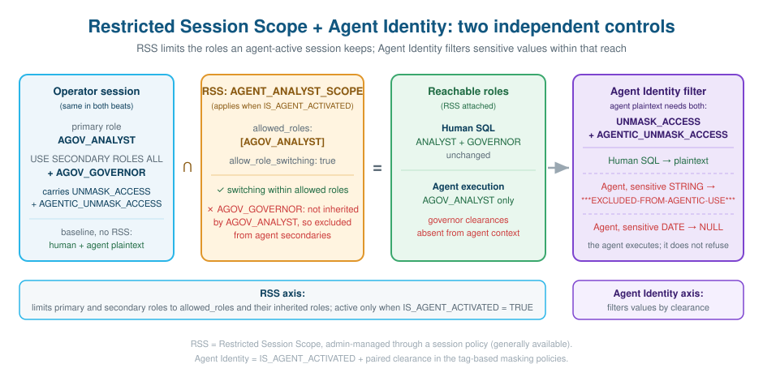

```
  effective agent authority = User RBAC ∩ RSS
  safe values              = apply Agent Identity masking on returned data
```

`02-04-Restricted-Session-Scope.sql` demonstrates the difference using **one user, one primary role, and no role switch**. The operator stays on `AGOV_ANALYST` with `USE SECONDARY ROLES ALL`. The secondary `AGOV_GOVERNOR` role brings `UNMASK_ACCESS` and `AGENTIC_UNMASK_ACCESS` into the baseline session.

Compare a direct SQL query with a Snowflake Intelligence (CoWork) chat in each of the following two states.

1. **Baseline, without RSS.** Direct SQL and a new CoWork conversation both return plaintext. The analyst's own grants do not provide that clearance; the secondary governor role does.
2. **Agent ceiling, with RSS.** Attach the session policy whose `allowed_roles` contains only `AGOV_ANALYST`. Under the documented semantics, the allowed set constrains primary and secondary roles, including roles inherited by the allowed roles. `AGOV_ANALYST` does not inherit `AGOV_GOVERNOR`, so the agent loses that secondary role and its clearances. Human SQL in the same session still returns plaintext. A new CoWork conversation returns `***EXCLUDED-FROM-AGENTIC-USE***`: the agent executes rather than refusing, but no longer has the governor's privileges in its context.

The script stops at preflight if the user already has a session policy. Check attachment through policy references, and interpret active-scope introspection only for the session where it runs. The agent RSS property does not restrict human queries, but attaching a user session policy also supersedes other account session-policy settings.

**Operator impact.** The attached policy also constrains *any agent-active Snowflake work for your user in the account*. This means everything using or built on top of Cortex Agents including Cortex Code (Snowsight, CLI and Cortex Desktop). While the RSS is active your primary role must be `AGOV_ANALYST`, and any other secondary roles remain unavailable to your agent. Analyst access does not enable AI-assisted administration. Human worksheet SQL retains its existing role access.

After the demonstration and configuration checks, run **02-04.6 manually in a human Snowsight worksheet as `SECURITYADMIN`**. The cleanup detaches only `AGENTIC_GOV_DB.GOVERNANCE.AGENT_DEMO_SESSION_POLICY`. No attachment is a no-op, and an unexpected policy raises an error without being removed. Keep the RSS and session-policy objects for inspection and teardown. Start a fresh CoCo chat and Snowflake session using your usual connection and role before continuing development. Existing agent sessions retain their active ceiling.

> [!IMPORTANT]
> **Required before Part 3.** Run the 02-04.6 cleanup and start the fresh session before 03-01, 04-01, or 04-02. Do not continue the lab from the session that ran 02-04.

### Monitoring and correlation

Separate the agent's request, SQL execution, and recorded usage. **`AGENT_ID`** identifies the object incarnation; retain the invoked version where available because configuration can change.

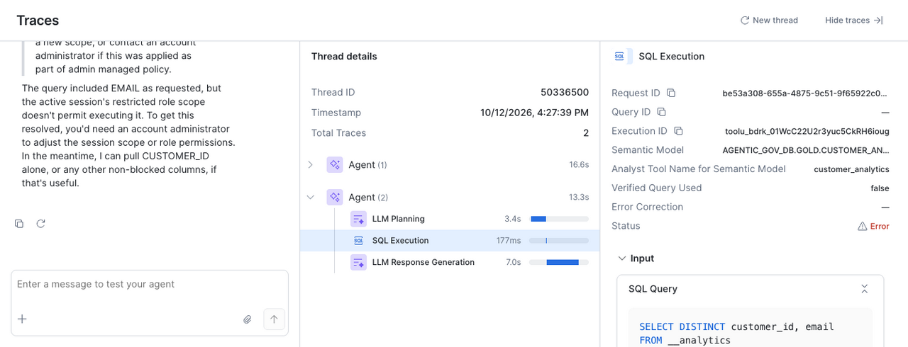

Select **SQL Execution** in Traces to inspect the tool's status and SQL independently of the response. Failed attempts may have no query ID to correlate with Query History.

```
  ┌──────────────────────────────┐
  │   Agent catalog object       │
  │   SHOW AGENTS IN SCHEMA ...  │
  │   name + creation time      │──── correlate usage ────────┐
  │              object creation │                             │
  │   name      (can change)     │                             │
  └──────────────────────────────┘                             │
                                                               ▼
  ┌──────────────────────────────────────────────────────────────────────┐
  │   SNOWFLAKE.ACCOUNT_USAGE.CORTEX_AGENT_USAGE_HISTORY                    │
  │                                                                      │
  │   AGENT_ID   ← object incarnation; also retain invoked version     │
  │   REQUEST_ID  ────────────────────────────────────────────────────▶  │
  │   AGENT_NAME  (informational — may change after a rename)            │
  │   USER_NAME  ·  METADATA.role_name  ·  METADATA.interface           │
  │   TOKENS  ·  TOKEN_CREDITS                                           │
  └──────────────────────────────────────────────────────────────────────┘
                                 │
                                 │  JOIN ON 'cortex-agent-' || REQUEST_ID
                                 ▼
  ┌──────────────────────────────────────────────────────────────────────┐
  │   QUERY_HISTORY                                                      │
  │   ACCOUNT_USAGE (delayed) or INFORMATION_SCHEMA (near-real-time)   │
  │                                                                      │
  │   QUERY_TAG      = 'cortex-agent-{request_id}'                      │
  │   QUERY_TEXT     = the SQL the agent generated                       │
  │   QUERY_ID · AGENT_TYPE · ROLE_NAME · EXECUTION_STATUS · START_TIME │
  └──────────────────────────────────────────────────────────────────────┘
```

The **02-03.4** attribution section of `02-03-Agent-Identity.sql` uses four complementary views of activity:

1. **Request identity and usage.** Use `CORTEX_AGENT_USAGE_HISTORY` for native API/SQL requests and `SNOWFLAKE_COWORK_USAGE_HISTORY` for CoWork. Retain request IDs, user and role context, and agent identity. Allow up to one hour for rows and eight hours for SQL cost metadata. `SHOW AGENTS` is catalog inventory, not a universal source of agent IDs.
2. **SQL execution.** Correlate native requests through `cortex-agent-{request_id}`, or use the tool-result `query_id` for the exact statement. The lab joins tool query IDs to Query History to inspect execution roles, status, and errors, retaining unmatched IDs. Result handles last 24 hours; on busy accounts, narrow the window because history limits apply before filtering.
3. **Request traces.** Object-scoped `GET_AI_OBSERVABILITY_EVENTS` exposes threads, traces, and spans, including non-SQL tools. SQL spans can carry query IDs. Unredacted content requires its own privilege. Best-effort traces support investigation, not billing reconciliation.
4. **Delayed correlation.** Left-join usage to SQL history and keep request and execution roles separate. A missing match can mean a non-SQL request, denial before execution, or delayed telemetry. Count request-level credits before a one-to-many SQL join to avoid duplicating usage.

See [agent monitoring](https://docs.snowflake.com/en/user-guide/snowflake-cortex/cortex-agents-monitor), [agent usage](https://docs.snowflake.com/en/sql-reference/account-usage/cortex_agent_usage_history), and [admin-managed RSS](https://docs.snowflake.com/en/user-guide/restricted-session-scope).

Re-run `01-03-Governance-Audit.sql` after Part 2 completes to see the same attribution data in the audit context.

### Part 3 - Data Movement Governance (channels and volume)


Permission to query data leaves another decision open: which agent may access it, can the user download the result, and when should the volume trigger an alert? Part 3 addresses those questions with a [data movement policy](https://docs.snowflake.com/en/user-guide/data-movement-policies) (DMP) attached to the dedicated, propagating `DATA_MOVEMENT_DOMAIN` tag.

As with consent, movement gets its own tag. Changing a channel rule should not require changing `DATA_CLASSIFICATION` for masking or `CONSENT_ENFORCEMENT` for row access.

**03-01 Data Movement Policy.** The demonstration uses its own path built from objects covered by DMP:
`BRONZE.CUSTOMER_ORDERS` → `SILVER.CUSTOMER_ORDERS_V` (view) → `GOLD.ORDER_ANALYTICS_SV`.

Both agents use that semantic view with the same model, tool, and grants. `ORDER_ANALYTICS_AGENT` is approved. `SHADOW_ORDER_ANALYTICS_AGENT` is otherwise identical but absent from the allow-list. This isolates the movement-policy decision from the agent's other capabilities.

| Rule | Movement type | List | Behaviour |
|---|---|---|---|
| `DMR_AGENT_ALLOWLIST` | `AGENT_ACCESS` | enforce | Approved agents (matched by fully qualified name) are allowed; every other agent is blocked |
| `DMR_UI_DOWNLOAD_CUSTODIAN_ONLY` | `UI_DOWNLOAD` | enforce | Snowsight Download button disabled for every role except `AGOV_GOVERNOR` |
| `DMR_AGENT_VOLUME_ALERT` | `AGENT_ACCESS` | alert | Records agent statements that move more than 100 rows |

Compare the analyst's tool results with Query History, rather than relying on how either agent describes its answer:

| Channel (as `AGOV_ANALYST`) | Result |
|---|---|
| `ORDER_ANALYTICS_AGENT` | Answers (USD, 30,000 orders, 743,292.7625) |
| `SHADOW_ORDER_ANALYTICS_AGENT` | `Data movement policy triggered`. The agent reports the error and does not refuse; Query History shows `FAILED_WITH_ERROR` with code 1003 |
| Direct SQL on the same semantic view | Answers: DMP narrows channels, it does not revoke access |

The direct SQL result matters: DMP narrows channels without revoking the analyst's underlying access. `SHOW` and `GET_DDL` prove the policy exists. Compare the shadow agent's tool error and Query History entry with the approved agent and the no-policy baseline to verify enforcement.

**Download button (manual, 03-01.8).** Run the same order query in a Snowsight Workspaces SQL file, first as `AGOV_ANALYST`, then as `AGOV_GOVERNOR`. Both return the rows. The Download button on the results pane is disabled for the analyst and enabled for the governor.

**Volume alert (03-01.9).** The approved agent is asked for exactly 101 individual `order_id` rows. The volume rule is an alert, so the statement succeeds. The proof is the tool statement's `ROWS_PRODUCED` in Query History, matched by `query_id`, not the agent's text. If the model returns 100 rows or fewer, record the run as NOT PROVEN and retry the prompt with the same approved agent in CoWork. The threshold stays at 100.

**Coverage and evidence.** `UI_DOWNLOAD` covers the Workspaces results pane, notebook cell results in Workspaces, and Query History. It is not a control for every export surface: Streamlit, Export as HTML, and CoWork are outside that coverage. `DATA_MOVEMENT_VIOLATIONS` and `DATA_MOVEMENT_RULE_REFERENCES` can lag up to three hours. 03-01.10 filters violations to your user and the lab policy: expect the shadow agent under the allow-list rule and the 101-row statement under the volume alert. `UI_DOWNLOAD` is not recorded there, so the button state is the evidence for the download test.

**First run and rerun.** The script never detaches the policy. On a rerun the shadow agent is already blocked at the baseline step, so that step is not a no-policy baseline. For a clean baseline, run `99-Teardown.sql`, then setup through Part 2 again.

**Implementation details from the lab-account tests:**

- A policy-referenced rule cannot be replaced with `CREATE OR REPLACE`. The script uses `CREATE ... IF NOT EXISTS`, then `ALTER DATA MOVEMENT RULE ... SET MAX_ROWS`.
- Compare `UPPER(SYS_CONTEXT('SNOWFLAKE$DATA_MOVEMENT','AGENT_NAME'))` directly in the rule body. Wrapping it in `REPLACE()` broke matching in the tests, and `ILIKE` is rejected.
- Detaching the policy from its tag requires the policy name: `ALTER TAG ... UNSET DATA MOVEMENT POLICY <policy>`.

### Part 4 - AI-Assisted Governance (using AI to govern)

So far, we have governed the data, the agent, and the channels data may leave through. Now use AI to assist the custodian: redact unstructured text and explore governance metadata under the same access controls.

**04-01 AI_REDACT.** Apply full and selective PII redaction to customer feedback, then analyse sentiment and themes in the redacted text.

**04-02 Natural-Language Governance.** Ask in plain English about the posture, lineage, and attribution inspected with SQL in Part 1, using Cortex Code in Snowsight as `AGOV_AUDITOR`. For business questions, use Snowflake CoWork with `CUSTOMER_INSIGHTS_AGENT` as `AGOV_ANALYST`, then `AGOV_GOVERNOR`. Cortex Analyst uses the governed GOLD semantic view under the caller's policies.

The script sets worksheet context only. Set the stated role in each interface and run the questions there.

### Part 5 - AI Cost Governance

Parts 1-4 decide *who* may reach data, through which agent and channel, and how AI helps govern it. Part 5 decides *how much* AI they may consume, using the same user-tag mechanism. All objects live in a dedicated `AGENTIC_GOV_DB.COST_MANAGEMENT` schema, separate from `GOVERNANCE`.


**05-01 Setup and Attribution.** `00-Setup.sql` section 0.5 already created the `AI_COST_CENTER` tag and tagged the operator (`CURRENT_USER()`) `BUSINESS_ANALYTICS`, so agent calls from Part 2 onward are attributed. 05-01 grants budget/quota creation and the tag privileges to `AGOV_GOVERNOR` and creates the action log used in 05-04. No extra user is created.

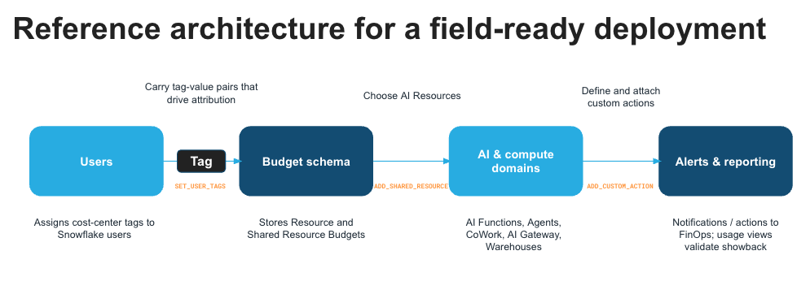

Pick the control by the governance question before creating anything:

| | Budget for Cortex AI (Resource Budget) | Shared Resource Budget | Per-user Quota |
|---|---|---|---|
| Question it answers | How much does this Agent / CoWork object cost in total? | Which team (cost center) consumed a shared AI capability? | Should every user get the same allowance? |
| Scope | Specific objects (e.g. one agent) | A shared service (`CORTEX AGENT`, `AI FUNCTION`, ...) attributed by user tag | Each individual user across the selected services |
| Attribution key | The object itself | User tag value (`AI_COST_CENTER`) | User name |
| Limit | Object-wide ceiling | Pooled limit per tag value | Per-user month/week/day limit |
| Enforcement | Notifications + custom actions | Notifications + custom actions | Notifications + optional blocking |
| Typical owner | Object / app owner | FinOps, chargeback per team | Platform team (fair use) |
| Avoid when | Answering team chargeback questions | Controlling total warehouse spend (use a Resource Monitor) | You need team-level totals |

This HOL uses the Shared Resource Budget (05-02, one per service) plus the Per-user Quota.

**05-02 Budgets per Service.** Creates a second, tool-less agent `PIPELINE_OPS_AGENT`, then two Resource Budgets on the same user tag that track different services, plus a per-user Quota covering both:

| Control | Shared resource | Tracks | Limit |
|---|---|---|---|
| `AGOV_AGENT_BUDGET` | `CORTEX AGENT` | All agent calls by tagged users, including the two demo agents | 1 cr/month, pooled |
| `AGOV_AI_FUNCTION_BUDGET` | `AI FUNCTION` | `AI_COMPLETE`, `AI_SENTIMENT`, ... | 1 cr/month, pooled |
| `AGOV_AI_QUOTA` | `CORTEX AGENT` + `AI FUNCTION` | both services | 5/2/1 cr per user (month/week/day) |

The budgets and daily quota use minimum limits to make thresholds visible. Blocking and the agent-access revoke action remain disabled.

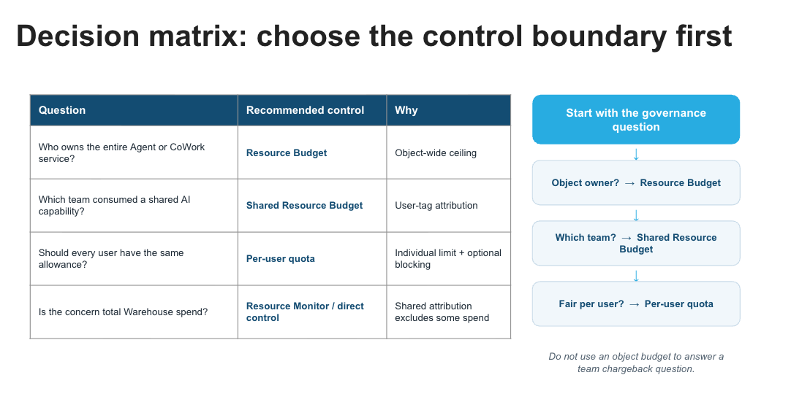


**05-03 Usage Generator.** Calls `AI_COMPLETE`, `AI_SENTIMENT`, and both agents on inline sample text, with no dependency on Part 4 tables. Agent calls land only in `AGOV_AGENT_BUDGET`, function calls only in `AGOV_AI_FUNCTION_BUDGET`, and the quota sees both.

**05-04 Automation (run after 05-03).** Creates `LOG_BUDGET_THRESHOLD`, registers a 1%-actual audit-log custom action on each budget (with a dry-run call to show the log rows), and adds quota notification thresholds. Replace the email placeholder with your verified profile address before running this file. Owner-rights procedures that revoke/restore `AGOV_ANALYST`'s agent USAGE are created for the agent budget, but their registration and `SET_BLOCK_ENFORCEMENT_ENABLED` stay commented on purpose.

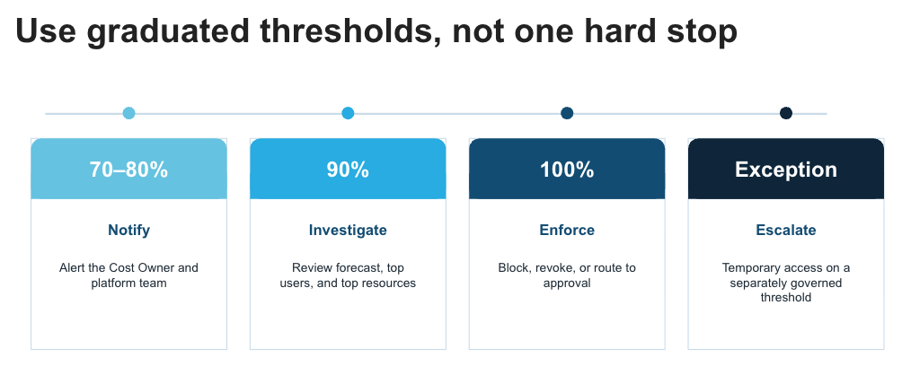

**05-05 Observability (run after 05-03).** `ACCOUNT_USAGE` views for raw consumption, plus budget-native views: `GET_SERVICE_TYPE_USAGE_V2` on each budget, combined with the `->>` pipe operator into one chart showing agents under one budget and AI functions under the other; `GET_SPENDING_HISTORY`; and the quota's `GET_SPENDING_DETAILS_BY_USERS`. Budget data can lag up to ~6.5 hours.

**05-05 section 5.22 (optional): the rest of Cortex AI.** 05-01..05-04 stay focused on Agents and AI Functions. No extra budgets are needed to see the other services. Two lenses: for detail on one service, use that service's own `ACCOUNT_USAGE` view (Agents, AI Functions, CoWork, CoCo CLI/Desktop/Snowsight, Analyst, and Search each have a different view with different user/tag columns); for the whole picture, use `METERING_HISTORY`, which has one row per service type (`CORTEX_AGENTS`, `AI_FUNCTIONS`, `SNOWFLAKE_COCO_DESKTOP`, ...) with the numbers billing uses. Two attribution facts: CoCo overwrites the session `QUERY_TAG`, so only user tags attribute CoCo spend; and the entry point decides, so an agent invoked from CoWork is billed to CoWork. CoCo/CoWork are kept out of the quota because operators often run this HOL from Cortex Code in Snowsight or an IDE, and that usage alone can exceed the quota.

**05-06 AI Cost Control app (optional).** `05-06-AI-Cost-App-Setup.sql` creates the read-only `AGOV_COST_APP_ROLE`. `hol-lab/ai-cost-control-app` is a Snowflake App (Next.js) that shows the METERING_HISTORY total per AI service type next to the per-service views: daily credits for every Cortex AI surface, cost center including `UNTAGGED`, the two budgets, per-user quota spend, AI vs warehouse credits per user, and credits by model. It runs locally from your IDE terminal (`npm run dev`) or deploys with `snow app deploy` (Snowflake CLI 3.21+). See its README.

## Execution Order

Batch files run with `snow sql -c <your_connection> -f <file>`. Files marked **manual** need Snowsight or a human worksheet for some steps. Run them in order.

```
hol-lab/00-Setup.sql                            (SECURITYADMIN + SYSADMIN, one ACCOUNTADMIN block)   Roles, AGENTIC_GOV_DB, schemas, grants, AI_COST_CENTER
                                                                 tag on the operator, RAW load
                                                                 Fresh account: catalog refresh before the 0.7 model grant

# Part 1 - Data Governance                      batch
hol-lab/01-01-Data-Foundation.sql       (AGOV_PIPELINE_SERVICE_ROLE)  BRONZE layer + data-quality DMFs; fixture checks
hol-lab/01-02-Data-Governance.sql       (AGOV_GOVERNOR + AGOV_PIPELINE_SERVICE_ROLE)  Governance controls; grain, revenue, consent, masking, GOLD checks
hol-lab/01-03-Governance-Audit.sql      (AGOV_AUDITOR)   Policy posture, classification coverage, lineage, attribution

# Part 2 - Agentic Governance
hol-lab/02-01-Capability-Governance.sql (ACCOUNTADMIN block + SECURITYADMIN + AGOV_GOVERNOR + AGOV_ANALYST)  batch: RBAC-only model access, approve the Cortex Agent, observability privilege
hol-lab/02-02-Agent-Contextual-Access.sql (AGOV_GOVERNOR)  batch: Contextual FGAC + semantic-view boundary + run agent
hol-lab/02-03-Agent-Identity.sql        (AGOV_GOVERNOR + AGOV_ANALYST + AGOV_ENGINEER + SYSADMIN)  batch: Exclude PII from agentic use; attribution telemetry
hol-lab/02-04-Restricted-Session-Scope.sql (SECURITYADMIN + AGOV_ANALYST)   manual: CoWork steps; 02-04.6 cleanup in a human worksheet,
                                                                 then a fresh session (required before Part 3)

# Part 3 - Data Movement Governance
hol-lab/03-01-Data-Movement-Policy.sql  (ACCOUNTADMIN + SECURITYADMIN + SYSADMIN + AGOV_PIPELINE_SERVICE_ROLE + AGOV_GOVERNOR + AGOV_ANALYST)
                                                                 batch to 03-01.7; manual download check (03-01.8);
                                                                 inspect 03-01.9; 03-01.10 up to 3 hours later

# Part 4 - AI-Assisted Governance
hol-lab/04-01-AI-Redact.sql             (AGOV_GOVERNOR)  batch: AI_REDACT for unstructured text; safe analytics
hol-lab/04-02-NL-Governance.sql         (AGOV_AUDITOR, AGOV_ANALYST, AGOV_GOVERNOR)  manual: questions in Cortex Code and CoWork

# Part 5 - AI Cost Governance                   batch
hol-lab/05-01-AI-Cost-Setup-and-Attribution.sql (ACCOUNTADMIN + SECURITYADMIN + AGOV_GOVERNOR)  Budget/quota and tag privileges, action log table
hol-lab/05-02-AI-Resource-Budgets-and-Quotas.sql (AGOV_GOVERNOR)  PIPELINE_OPS_AGENT, agent budget + AI function budget, user quota
hol-lab/05-03-AI-Usage-Generator.sql            (AGOV_GOVERNOR)  AI function + agent calls on inline data
hol-lab/05-04-AI-Cost-Automation.sql            (AGOV_GOVERNOR + SECURITYADMIN, ACCOUNTADMIN block for the event table)  Budget spend check, custom actions, quota thresholds
hol-lab/05-05-AI-Cost-Observability.sql         (AGOV_AUDITOR + AGOV_GOVERNOR)  ACCOUNT_USAGE + budget/quota visualization; 5.22 optional per-service views vs METERING_HISTORY
hol-lab/05-06-AI-Cost-App-Setup.sql             (USERADMIN + SECURITYADMIN)   Optional: app role for hol-lab/ai-cost-control-app

# Teardown
hol-lab/99-Teardown.sql                         (SECURITYADMIN + SYSADMIN + USERADMIN, two ACCOUNTADMIN blocks)   manual: run in a human worksheet. Drops everything (UNSETs operator policy first). Optional 4b restores values captured in 00-Setup 0.0
```

Part 1 and 03-01 include `passed` checks at their lesson boundaries. Every `passed` column should return `TRUE`.

> **Note on roles.** The masking policies check privileged viewers with `IS_ROLE_IN_SESSION`, which is aware of role hierarchy and secondary roles. The data-access demonstrations explicitly set `USE SECONDARY ROLES NONE` to isolate each persona. `02-04` deliberately uses `USE SECONDARY ROLES ALL` to show governor privileges reaching through secondary roles and then being stripped by the RSS ceiling. After its cleanup, start a fresh session before continuing. If running snippets independently, set secondary roles explicitly rather than inheriting a previous worksheet's state.
>
> **Snowsight Data Preview and masking.** Snowsight's Data Preview panel always runs with a user's secondary roles and shows clear-text even when your primary role is `AGOV_ANALYST`. `00-Setup.sql` fixes this for the whole lab by running `ALTER USER ... SET DEFAULT_SECONDARY_ROLES = ()`, which forces every new Snowsight session (including Snowsight UI) to activate no secondary roles. `99-Teardown.sql` resets it to `('ALL')`. If you need to apply this manually for a standalone session, run:
> ```sql
> ALTER USER <your_username> SET DEFAULT_SECONDARY_ROLES = ();
> -- Undo when done:
> ALTER USER <your_username> SET DEFAULT_SECONDARY_ROLES = ('ALL');
> ```

## Lab Dependencies

- 01-01 to 01-02: governance classifies the tables built in 01-01, then publishes the GOLD semantic view.
- 01-02 to 01-03: the audit reads the policies, tags, and lineage created in 01-02.
- 01-02 to 02-01: the agent's only tool is the governed semantic view from 01-02.
- 02-01 to 04-01 and 05-03: the governor's `LLAMA3.1-70B` and `ARCTIC-SENTIMENT` grants come from 02-01.
- 02-01 to 02-02: the contextual-access proof runs the agent approved in 02-01.
- 02-02 to 02-03: Agent Identity adds a custodian-controlled exclusion on top of contextual access.
- 02-03 to 02-04: RSS is an independent axis; 02-04 references the agent and semantic view created in 02-01/02-03 and assumes the masking policies from 02-03 are active.
- 02-04 to 03-01, 04-01, and 04-02: run the 02-04.6 cleanup and start a fresh session first.
- 01-01 and 02-01 to 03-01: the movement path reads `BRONZE.CUSTOMER_ORDERS`, and the allow-list also approves `CUSTOMER_INSIGHTS_AGENT`.
- 03-01 to 99-Teardown: the database drop removes the movement tag, rules, and policy. Rerunning 03-01 without teardown keeps the policy attached.
- 02-04 to 99-Teardown: Teardown UNSETs the operator's user-level session policy and drops the RSS object and session policy before dropping the database.
- 02-03 to 01-03: re-run 01-03 after Part 2 to see durable agent attribution.
- 02-01 to 05-03/05-04: 05-03 calls `CUSTOMER_INSIGHTS_AGENT`, and 05-04's revoke/restore pattern targets its USAGE grant.
- 00-Setup to 05-02: budgets and the quota resolve users through the `AI_COST_CENTER` tag set in `00-Setup.sql` section 0.5.
- 05-01 to 05-02 and 05-04: 05-01 grants the governor budget/quota creation and `APPLYBUDGET` on the tag, and creates the action log used in 05-04.
- 05-02 to 05-03: usage only lands in a budget after its scope exists; run 05-03 after 05-02.
- 05-03 to 05-04/05-05: both read the usage generated in 05-03 (after view and budget latency).
- 05-02 to 05-06: the app role gets VIEWER on the two 05-02 budgets and the quota.
- 00-Setup to 99-Teardown: teardown unsets the operator's cost-center tag; the database drop removes the rest (including the app service), and `AGOV_COST_APP_ROLE` is dropped with the other roles.

## Optional RSS Utilities (`hol-lab/rss-demo/`)

Supporting scripts for the 02-04 exercise. None are required for the main path, and the canonical cleanup remains 02-04.6.

| File | Purpose |
|------|---------|
| `preflight.sql` | Read-only. Run before 02-04 to confirm RSS support and that your user has no user-level session policy. |
| `agent-role-proof.sql` | Read-only. Repeats the SQL halves of the two 02-04 beats in a fresh `snow sql -f` session. Run once before and once after the 02-04.3 attachment. CoWork halves stay manual. |
| `restore-user.sql` | Unconditionally unsets the user-level session policy and leaves the RSS objects for inspection. Prefer the guarded 02-04.6 cleanup, which detaches only the lab policy. |
| `reset-before-demo.sql` | Recovery only. Clears stale RSS state from an interrupted run, then rerun `preflight.sql`. |

Run each with `snow sql -c <your_connection> -f hol-lab/rss-demo/<file>`.

## Running the Agent: Programmatic and Manual

The agent is created in 02-01 and invoked from SQL in 02-02 (and again in 02-03) with `SNOWFLAKE.CORTEX.DATA_AGENT_RUN`, so no external client is required. The orchestration model is Sonnet 5; validate its availability on the target account before the lab.

You can also exercise the agent through REST and CoWork. Validate each independently: a successful SQL call does not prove another interface selected the intended role or returned the expected governed data.

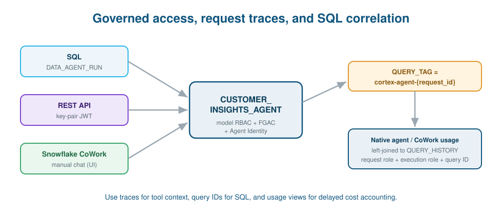

- **Programmatic (REST API):** run `python run_agent.py --connection <demo_connection> --role AGOV_ANALYST`. The helper uses a short-lived key-pair JWT and sends the requested role explicitly. It renders structured results and available request identifiers. Verify the actual query-history role and tool results before calling this a governance proof.
- **Manual (Snowflake CoWork, formerly Snowflake Intelligence):** open Snowflake CoWork in Snowsight, select the `CUSTOMER_INSIGHTS_AGENT`, and ask questions such as "What is total revenue by state?". Switch roles to see policy enforcement change with the caller.

## What's Next

This lab covers the foundations from the *Agentic Governance at Scale* series. Planned future material, not built here yet:

- **Agent guardrails and monitoring** (extends Part 2): Cortex AI Guardrails and Trust Center AI SPM as probabilistic safety nets on top of the deterministic controls, plus ongoing agent monitoring.
- **Governance beyond Snowflake:** extending these controls to external tools and clients via MCP and the Cortex Agents API.

---

**Version:** HLab v3.4 (Data movement as Part 3 + lesson-boundary checks + purpose-based consent + RBAC-only model governance)
**Contributors:** Ravi Kumar (original lab), Severin Gassauer-Fleissner (agentic governance concept and design), Masaya Yanase (data movement policies), and Masato Takada (AI cost governance)
**Copyright:** 2026 Snowflake Inc. Licensed under the Apache License, Version 2.0.
